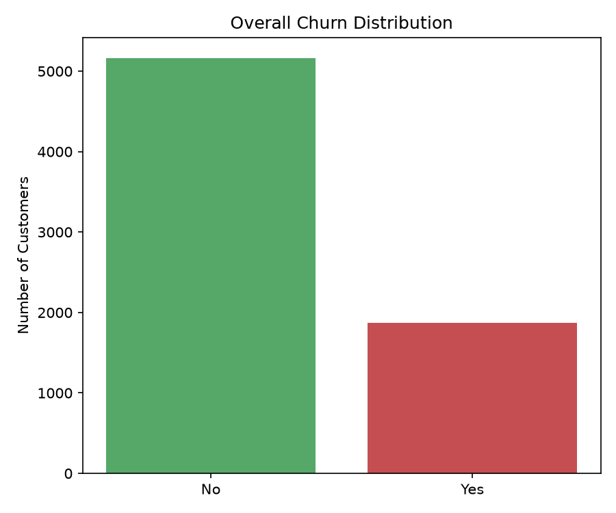
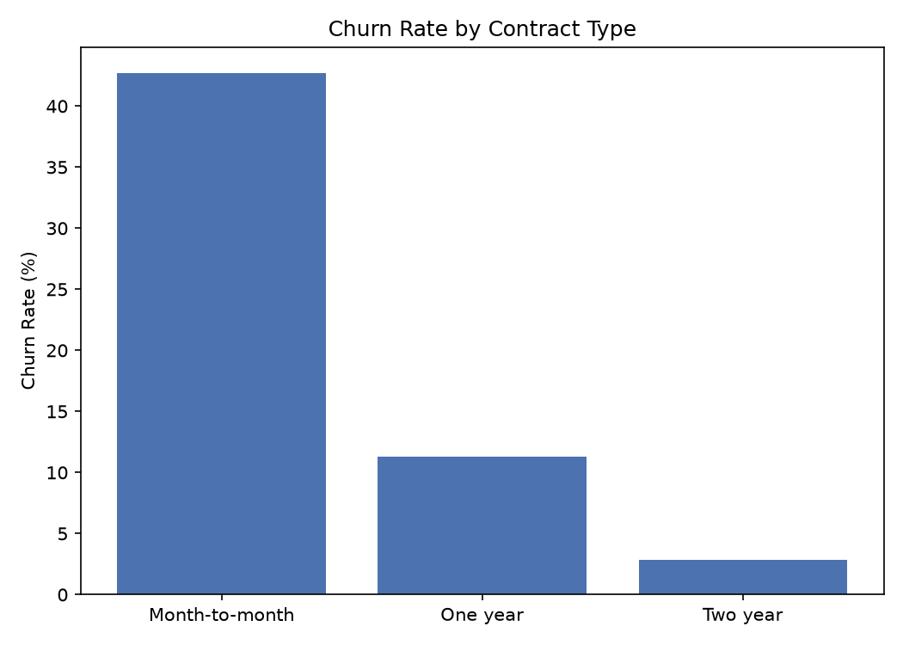
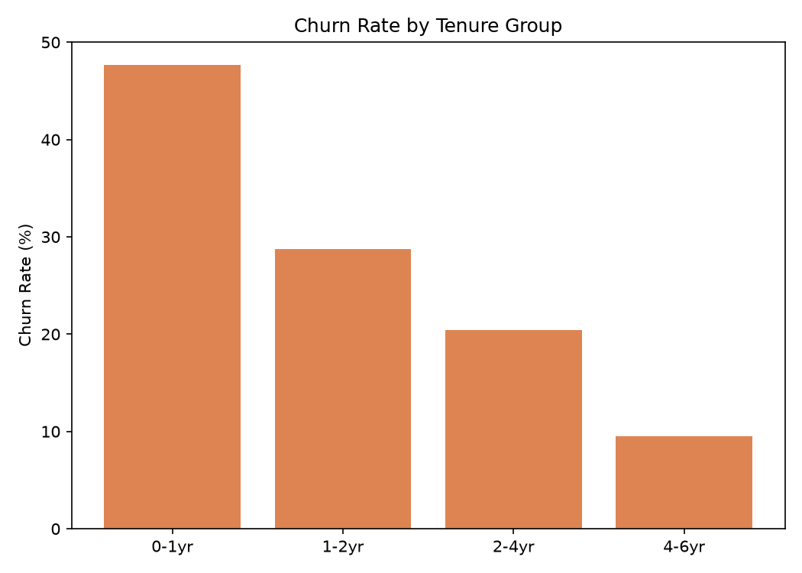
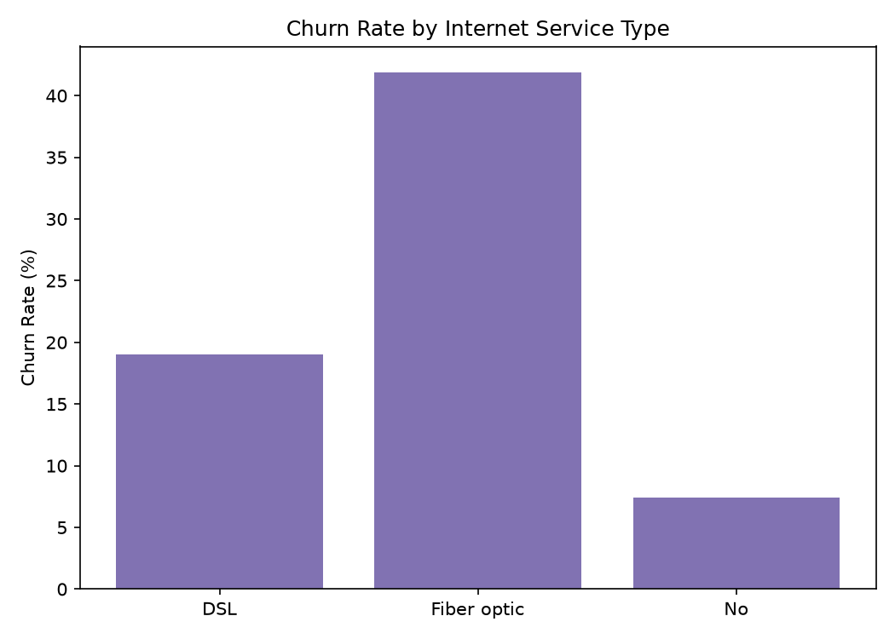
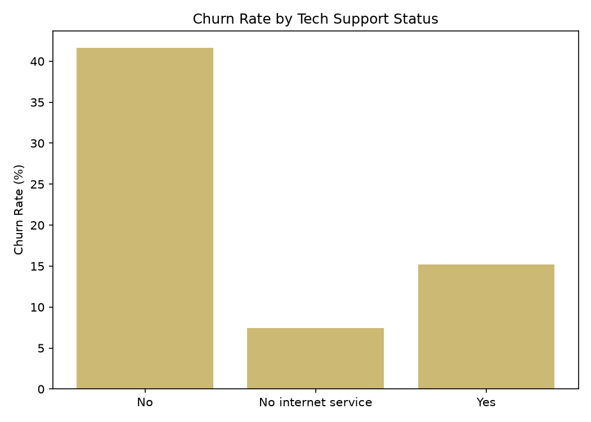
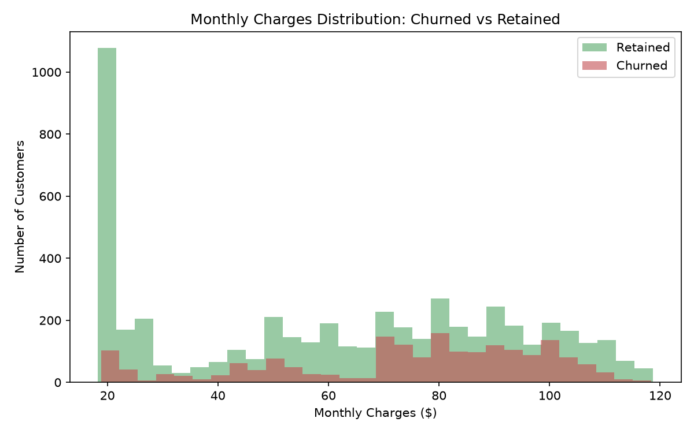
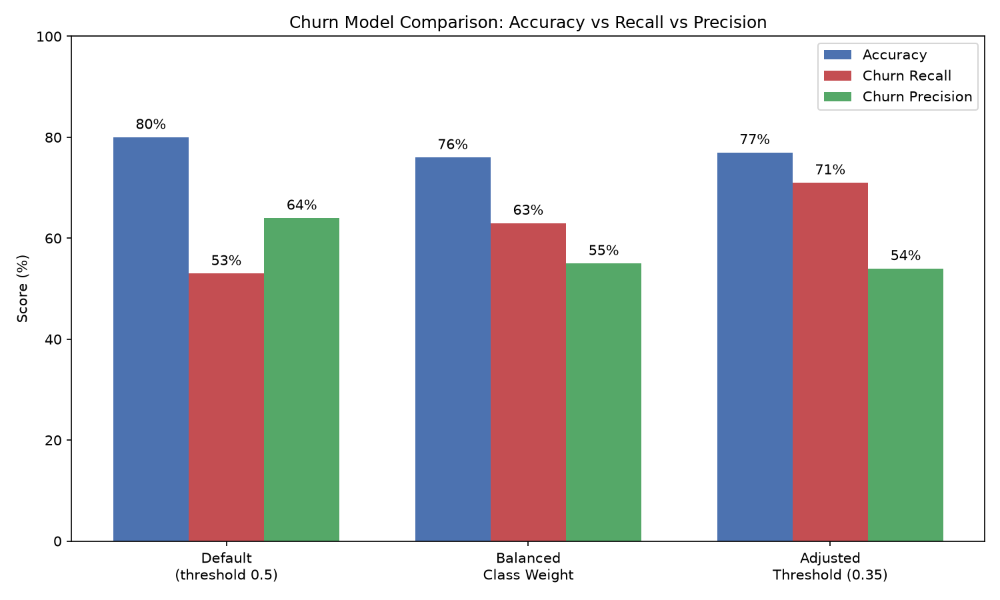

# Telco Customer Churn Analysis & Prediction

Finding out why customers leave a telecom company, and building a model that flags customers at risk of churning so retention offers can be targeted.

**Tools:** Python, pandas, matplotlib, scikit-learn

---

## The Problem

Losing customers costs more than keeping them. This project answers two questions:

1. **Why do customers churn?** (exploratory analysis)
2. **Which customers are likely to churn next?** (predictive model)

## Dataset

[Telco Customer Churn (Kaggle, blastchar)](https://www.kaggle.com/datasets/blastchar/telco-customer-churn): 7,043 customers with demographics, account details, subscribed services and a churn label.

## Data Cleaning

- Converted `TotalCharges` from text to numeric (it contained blank strings)
- Dropped the rows where `TotalCharges` was missing
- Final dataset: **7,032 customers**

## Exploratory Analysis

### Overall churn
[ADD your overall churn rate, e.g. "X% of customers churned".]



### Churn by contract type
[ADD your exact percentages for month-to-month, one-year and two-year contracts.]
Month-to-month customers churn far more than customers on longer contracts. This is the strongest driver found in this analysis.



### Churn by tenure
[ADD your exact percentages per tenure group.]
Churn risk is concentrated in a customer's first year.



### Churn by internet service
[ADD your exact percentages for Fiber optic, DSL and No internet.]



### Churn by tech support
[ADD your exact percentages for customers with and without tech support.]



### Monthly charges: churned vs retained
[ADD one sentence, e.g. average monthly charge for churned vs retained customers.]



## Predictive Model

Logistic regression, trained on 80% of the data and tested on 20% (stratified split so the churn ratio is the same in both). Three configurations were compared, because for retention the key metric is **recall on churners** (how many real churners the model catches), not just overall accuracy.

| Model | Accuracy | Churn Recall | Churn Precision | Missed Churners | False Alarms |
|---|---|---|---|---|---|
| 1. Default (threshold 0.5) | 80% | 53% | 64% | 175 | 110 |
| 2. Balanced class weight | 76% | 63% | 55% | ~138 | ~181 |
| 3. Adjusted threshold (0.35) | 77% | 71% | 54% | 107 | 223 |



**Recommended: Model 3.** It catches 71% of churners (267 of 374) versus 53% for the default model. The cost is more false alarms, which is acceptable when the retention action is cheap (an email or a small discount) and a lost customer is expensive.

**Limitations:** this is a simple baseline model. A tree-based model or more feature engineering could improve results, and the threshold should be tuned to the real cost of a retention offer.

## Recommendations

1. Target month-to-month customers, especially in their first 12 months, with a retention offer or an incentive to move to a longer contract.
2. Bundle or trial Tech Support and Online Security, since customers without them churn more.
3. Use the model's churn flags together with these segment rules to prioritize outreach.

## Project Structure

```
02-churn-analysis/
  Telco-Customer-Churn.csv
  analysis.ipynb
  churn_overall.png
  churn_by_contract.png
  churn_by_tenure.png
  churn_by_internet.png
  churn_by_techsupport.png
  churn_by_monthly_charges.png
  model_comparison.png
  README.md
```

## How to Run

```bash
pip install pandas matplotlib scikit-learn
python clean_and_eda.py
python churn_model.py
```

## Skills Demonstrated

Data cleaning, exploratory data analysis, data visualization, classification modeling, handling class imbalance, threshold tuning, translating model results into business recommendations.
